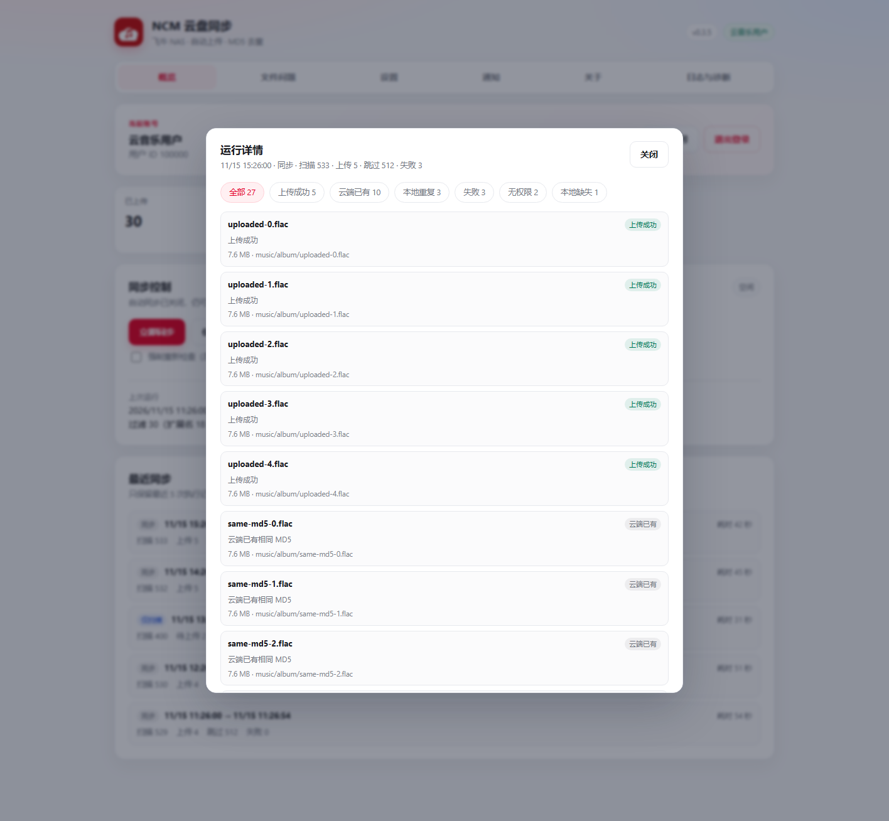

# NCM Cloud Sync

把本地音乐自动同步到**网易云音乐「音乐云盘」**的飞牛 NAS（fnOS）原生应用。内置 Web UI，支持扫码登录、本地与云端双重去重、仅扫描对账、运行历史、同步后处理、每日签到、权限体检和云盘容量校验。

> 非官方项目。网易云没有公开上传 API，本项目依赖从桌面客户端整理出的 weapi / eapi / NOS 上传链路，接口随时可能变化。使用前请先看[风险与限制](#风险与限制)。

> 项目原名 `wy-music-cloud`。0.3.0 起改为 **NCM Cloud Sync**，fnOS 应用标识为 `ncm-cloud-sync`，Python 包为 `ncm_cloud_sync`，CLI 为 `ncm-cloud-sync`。应用中心不会把 0.2.x 当成可升级版本，迁移步骤见[从 0.2.x 迁移](#从-02x-迁移)。




## 功能

- **原生飞牛应用**：`.fpk` 安装，带安装向导、启停、升级和卸载回调，不需要 Docker。
- **内置 Web UI**：登录、同步状态、统计、设置、通知、运行历史和日志都在界面里完成。
- **多层去重**：本地 MD5、云盘列表 `privateCloud.md5`、云端上传查重三道检查，避免重复上传。
- **仅扫描对账**：只读扫描本地目录和云盘列表，显示待上传、已匹配、本地重复和云端独有，不写同步状态、不上传。
- **运行历史**：保留最近 5 次有同步结果的执行记录，可点开查看逐文件结果；空跑和更早的记录自动清理。
- **统计明细**：已上传、待处理、本地缺失、跳过/重复都可以点开查看逐文件列表。
- **权限体检**：检查应用账号能否读取音乐目录，列出无权限的文件和目录示例，并引导到飞牛文件管理里给应用账号授权。
- **同步后处理**：只对本次上传或补建成功的文件，可选删除本地文件或移动到指定目录；默认不处理，不会处理已存在/未变更的文件。
- **歌词跟随**：删除或移动音乐时，同目录同名 `.lrc` 歌词会一起删除或移动，移动后跟随音频新文件名；没有歌词不影响操作，上传不涉及歌词。
- **每日签到**：可选开启，默认关闭；开启后每天在设定时间范围（默认 08:00–23:00）内随机时间签到一次，范围可自定义，设置页显示今日签到时刻和结果，首页账号栏可手动签到。签到现在走云贝中心接口，记录会出现在网易云 App 的云贝收支订单里。签到只领取云贝，不增加云盘空间；自动签到需自行评估风控风险。
- **云盘容量**：账号卡显示已用 / 总量 / 剩余和占用比例；上传前校验剩余空间。
- **同步通知**：支持 Telegram、Bark、ntfy、Gotify、Discord、Slack、钉钉、Server酱、PushPlus、Pushover、PushDeer、Webhook 和 SMTP；默认只在有上传或补建时通知，空跑可单独开启。
- **自动同步开关**：可以关闭后台自动同步，只保留手动执行。
- **增量同步**：SQLite 记录路径、大小、修改时间和 MD5，文件没变不重复计算、不重复上传。
- **失败隔离**：单个文件失败只影响它自己，下一轮继续；可以重置失败状态后重试。
- **多目录、多格式**：可配置多个音乐目录，支持 mp3、flac、m4a、aac、ogg、opus、wav 等。
- **元信息补全**：默认开启；上传前从网易云搜索并补全缺失的标题、艺术家、专辑，只补缺失字段、不覆盖已有标签，匹配不可靠时跳过。兼容“歌手 - 歌名”和“歌名 - 歌手”两种文件名，翻唱结果会提取原曲信息；运行记录显示检查/补全/未匹配数量。
- **元数据写入**：用 mutagen 读取标题、艺术家和专辑，上传时一并提交；没有标签时回退到文件名。

## 工作流程

```text
扫描 music_dirs
   │
   ├─ 扩展名 / 排除目录 / 大小过滤
   ├─ size + mtime 未变且已处理 ──► up_to_date
   ├─ 计算 MD5
   │    ├─ 本地已有同 MD5 ──► skipped_local
   │    ├─ 云盘列表已有同 MD5 ──► skipped_remote
   │    └─ 云端查重 needUpload=false ──► 不申请上传 token、不上传字节，补建条目
   └─ 上传：鲸鱼 token alloc → NOS 上传 → musicupload eapi info/v2 → eapi pub/v2
          ├─ 字节上传成功 ──► uploaded
          └─ 仅补建云盘条目 ──► linked
```

去重顺序是“先本地、再云盘列表、最后云端字节”。`needUpload=false` 只代表文件字节已经在网易云对象存储里，不代表云盘列表已经有条目，因此程序仍会调用 info/v2 和 pub/v2 补建云盘条目。这一步不申请上传 token、不上传新字节，也不增加上传数或上传字节数，单独显示为“补建”。

统计口径：先扫描出本地候选数（scanned），再逐文件处理（processed）；被扩展名、排除目录、大小或权限过滤的文件不计入 scanned，而是在“本地过滤”里单列。云盘列表每轮开始读取一次，转成内存中的 MD5 到 songId 映射；本地状态在 SQLite 中，逐文件对照后决定跳过或上传；本地记录显示“已上传”时也会确认该 MD5 仍在云盘列表中，云盘条目被删除或替换后会重新核对。概览里的统计卡可以点开查看逐文件明细；“待处理”在最近一次仅扫描后显示该次扫描的待上传文件。启用同步后处理时，只处理本次上传或补建成功的文件，删除和移动分别计入“已删除本地”“已移动本地”。

## 安装

### 环境要求

- fnOS **1.2.0 或更高版本**；
- x86_64 或 aarch64；
- 应用中心可以安装官方 `python312` 依赖（`manifest` 已声明 `install_dep_apps=python312`，安装时自动处理）。

不需要 Docker，也不需要 NAS 上预装 Python 包；运行时依赖已经随 `.fpk` 打包在应用目录中。

### 获取安装包

从 [Releases](https://github.com/jiu-zui-90817/ncm-cloud-sync/releases) 下载最新的 `ncm-cloud-sync-<版本>.fpk`。

也可以自行构建：

```bash
git clone https://github.com/jiu-zui-90817/ncm-cloud-sync.git
cd ncm-cloud-sync
# 需要 fnOS 官方 fnpack，放到 .tools/ 或加入 PATH
bash scripts/build-fnos.sh
# 产物：dist/ncm-cloud-sync-<版本>.fpk
```

构建脚本会从 PyPI 下载 x86_64 / aarch64 的 cp312 离线 wheel，再调用 `fnpack` 打包；构建机需要网络，NAS 运行时不需要。

### 安装步骤

1. 在飞牛 NAS 文件管理里上传 `.fpk`；
2. 打开应用中心 → 手动安装 → 选择文件；
3. 按向导填写音乐目录、同步间隔和日志级别；
4. 安装完成后启动应用。

安装向导字段：

| 项目 | 默认值 | 说明 |
| --- | --- | --- |
| 音乐目录 | `/vol1/1000/Music` | NAS 上的绝对路径，必须已存在；应用只读扫描 |
| 同步间隔 | `3600` | 秒，最小 60，最大 86400 |
| 日志级别 | `INFO` | `DEBUG` / `INFO` / `WARNING` / `ERROR` |

如果音乐目录的权限不允许应用包用户读取，请在应用中心授权目录，或在文件管理里给应用用户 `ncm-cloud-sync` 增加读取权限。安装设置保存在应用数据目录的 `settings.json`，升级和修改配置会保留。

### 从 0.2.x 迁移

0.3.0 改了应用标识、包用户、数据目录和 Python 包名，应用中心不会把它当成 0.2.x 的升级。旧版本可以继续保留，确认新版本可用后再卸载。

1. 停止旧应用，备份 `/var/apps/wy-music-cloud/var`；
2. 安装新的 `ncm-cloud-sync-<版本>.fpk`，启动一次让新数据目录生成，然后停止；
3. 把旧目录里的 `settings.json` 和 `data/` 复制到 `/var/apps/ncm-cloud-sync/var/`，确认属主是新的应用用户 `ncm-cloud-sync`；
4. 启动新应用，检查账号、音乐目录、排除目录和通知配置；登录态失效时重新扫码；
5. 确认同步正常后再卸载旧应用，卸载前不要删除旧数据目录。

环境变量前缀从 `WY_MUSIC_` 改为 `NCM_CLOUD_SYNC_`，Web 请求头改为 `X-NCM-Cloud-Sync`，Docker 服务名和容器名改为 `ncm-cloud-sync`；旧 `.env` 不会自动迁移。

## 打开与登录

### 打开 Web UI

在应用中心启动「NCM 云盘同步」，然后点击桌面图标或应用中心的“打开”。Web UI 通过飞牛统一网关加载，不需要额外端口，也不需要 SSH。

首次启动会初始化数据目录并拉起后台服务；如果页面暂时打不开，等几秒后刷新，或到应用数据目录查看 `app.log`。

### 扫码登录

1. 在 Web UI 点击「生成登录二维码」；
2. 用网易云音乐手机 App 扫码；
3. 在手机上确认登录；
4. 页面显示账号昵称后即可开始同步。

二维码有效期约 4 分钟，过期后重新生成。登录态保存在 `data/session.json`（权限 0600），请和状态库一起备份。

### Cookie 登录

扫码失败时，可以在登录卡片选择 Cookie 登录：在电脑浏览器登录 [music.163.com](https://music.163.com)，从开发者工具复制包含 `MUSIC_U` 的 Cookie，粘贴到页面保存。Cookie 等同账号登录凭证，不要分享。

### 登录失败时

- 确认手机上点了“确认登录”，并检查 NAS 时间是否准确；
- 二维码过期就重新生成；
- 在应用中心停止再启动应用，刷新页面后重试；
- 展开登录卡片的“查看诊断 / 日志”，点“复制诊断”获取版本、日志路径和最近日志；
- 仍然失败时改用 Cookie 登录。

## 首次同步

推荐顺序：

1. 点「仅扫描」：只读扫描本地目录和云盘列表，列出本地待上传、已匹配、本地重复、云端独有，不写同步状态；
2. 看统计里的“待上传 / 跳过 / 失败”是否符合预期；
3. 确认后点「立即同步」：先做上传前接口预检，通过后才开始处理文件；
4. 后续交给后台按间隔自动执行。

同步过程中可以点「暂停」：当前文件处理完后停下，并暂停后台自动同步，点「继续」恢复；点「终止」尽快结束当前一轮，但不会关闭自动同步，下一轮仍按计划运行。两者都不会删除已上传记录，未处理文件下一轮继续。

「立即同步」会先检查登录态、云盘列表和上传查重接口；任何一项不可用都会中止本轮并推送失败通知，不会申请上传 token，也不会写文件状态。

「仅扫描」完成后，概览的「待处理」会显示最近一次仅扫描得到的待上传数量；之后再执行真实同步时，仍以数据库中的待处理状态为准。

## 权限

应用以包用户 `ncm-cloud-sync` 运行，不是音乐文件的属主。文件由其他下载器或用户创建、权限为 600 时，应用无法读取。

飞牛自身的 ACL 不继承 Linux ACL，`setfacl` 对下载器先写临时文件再 rename 的文件也不可靠，因此程序不再生成或提供修复命令。请到「文件问题 → 权限体检」点「开始体检」，按页面列出的目录到「文件管理 → 权限设置 / 编辑权限」给 `ncm-cloud-sync` 增加读取权限；也可以在应用中心给本应用授权音乐目录。

授权后点“重置并重试”让失败文件重新排队。若下载器仍用 600 或 umask 077 创建文件，可把下载器 umask 调整为 022/002。应用本身没有 root，不能自动修改其他用户创建的文件的权限。

## 数据与备份

应用数据目录通常在 `/var/apps/ncm-cloud-sync/var`（以应用中心显示为准）：

```text
var/
├── settings.json      # 音乐目录、间隔、自动同步、通知配置、日志级别
├── app.log            # 应用日志，单文件 2 MB 自动轮转，保留 2 个备份
├── app.out            # 进程 stdout/stderr
├── app.pid
├── login.txt
└── data/
    ├── state.db       # SQLite 同步状态（去重核心）
    ├── session.json   # 登录态（敏感）
    ├── last_run.json  # 最近一次运行结果
    └── qr.png         # CLI 登录二维码（如使用过）
```

`app.log` 总占用上限约 6 MB；日志页会显示当前日志文件大小和上限。概览「最近同步」只保留最近 5 次执行记录，更早的记录连同明细自动清理。

建议备份 `settings.json`、`data/state.db`、`data/session.json`。`session.json` 等同于账号登录凭证，不要公开。

### 升级

在应用中心用新 `.fpk` 覆盖安装即可。升级回调会保留设置、状态和登录态，只替换程序文件。升级前建议备份 `settings.json`、`data/state.db`、`data/session.json`。

从 0.3.0/0.3.1 升级到当前版本时，数据目录属主会切到 `ncm-cloud-sync`。旧的 `wy-music-cloud` 系统用户不会自动删除，确认运行正常后可手动清理；如果音乐目录提示无权限，在应用中心重新授权。

### 备份与恢复

```bash
# 路径以应用中心显示为准
sudo tar czf ncm-cloud-sync-backup.tgz \
  -C /var/apps/ncm-cloud-sync/var \
  settings.json data/state.db data/session.json
```

恢复时停止应用，把文件放回对应位置，再启动。只恢复 `state.db` 也能工作；最坏情况下重新计算 MD5，云端查重仍会挡住重复上传。

### 卸载

在应用中心卸载。卸载回调默认保留数据目录，方便重装后继续使用。确定不再使用时，可以手动删除：

```bash
sudo rm -rf /var/apps/ncm-cloud-sync/var
```

删除前请确认路径；不同 fnOS 版本的目录可能不同。

## 常见问题

**页面打不开 / 502**

先确认应用状态是“运行中”。页面底部日志卡片点“查看诊断”，会显示真实的 `app.log` 路径、数据目录、Python、PID、Socket 和最近日志；即使日志文件因权限没写成，也能看到内存日志。首次启动需要等 Python 服务就绪，通常几秒。

**没有日志文件 / 日志是空的**

打开页面底部日志卡片，点“诊断信息”或“复制诊断”。它会列出 `app.log` 路径、文件是否存在、数据目录、Python、PID、Socket 和最近 120 行日志；即使 `app.log` 因权限没写成，也能看到内存日志。反馈问题时复制整段诊断内容即可。

**提示没有 python312**

在应用中心确认官方 `python312` 依赖已安装；如果安装失败，重新安装本应用，应用中心会重新处理依赖。

**扫码后手机提示“数据加载失败”或“服务器内部错误”**

先确认 NAS 时间准确，停止再启动应用，刷新页面后重新生成二维码。仍然失败时，展开登录卡片里的“查看诊断 / 日志”，点“复制诊断”获取版本和日志；同时可以改用 Cookie 登录。

**扫码后仍显示未登录**

确认手机上点了“确认登录”，二维码没有过期。退出登录后重试，或使用 Cookie 登录兜底。

**安装时提示“音乐目录不可用”**

按提示处理：`目录不存在` 检查路径；`没有读取权限` 到应用中心授权该目录，或在文件管理里给应用用户 `ncm-cloud-sync` 读权限；`必须是绝对路径` 确认以 `/` 开头。路径保持一行，目录名区分大小写。

**扫描不到音乐**

检查音乐目录是否是绝对路径、是否存在、应用包用户是否有读权限；再检查扩展名是否在允许列表，以及是否被排除目录或排除规则命中。

**很多文件提示没有读取权限**

到「文件问题 → 权限体检」点「开始体检」，按页面列出的目录到「文件管理 → 权限设置」给 `ncm-cloud-sync` 增加读取权限，或在应用中心重新授权音乐目录。授权后点“重置并重试”。

**同步失败 / 上传时提示 [400] 参数错误**

先看日志里的具体阶段和文件。常见原因是接口变动、Cookie 失效、网络问题或短时限流。重新登录、把“请求间隔”调大后再试；仍失败时复制诊断信息反馈。单个文件失败不会阻塞其他文件。

**上传时提示 [400] 接口调用失败（提交云盘信息）**

这是提交云盘条目的阶段失败。先确认登录态有效、网络可访问 `musicupload.netease.com`，再重试；日志会带文件名、songid、resourceId、host 和是否有 `MUSIC_U`，反馈时连同诊断信息一起提供。

**上传时提示 Connection refused / 无法获取上传节点**

检查 NAS 能否解析并访问 `wanproxy.127.net`。网络恢复后重试；LBS 节点全部不可用时会暂停本轮并保留待处理，不会刷屏。仍失败时把诊断信息里的网络错误发出来。

**同步时提示 [405] 操作频繁 / 上传接口被限流**

等 10～30 分钟让风控冷却，在设置里把“请求间隔”调到 1.5～3 秒，不要连续点“立即同步”。第一次遇到 405 会暂停本轮，当前文件标记为待处理，其余计入“待续”，下一轮自动继续。

**同步还没开始就提示“上传前接口检查失败”**

预检会检查登录态、云盘列表和上传查重接口。按提示处理：未登录就重新扫码或改用 Cookie；读不到云盘列表就检查网络和限流，稍后重试或调大请求间隔；查重接口不可用时通常是接口变动或短时限流，复制带 `[code]` 和 `url` 的日志反馈。「仅扫描」不调用查重接口，预检失败时仍可以用它查看差异。

**上传时提示“云盘剩余空间不足”**

每轮同步读取一次云盘容量，并在每个文件上传前按“总量 − 已用 − 本轮已上传字节”判断。空间不足的文件不会申请上传 token，会标记为失败，其他文件继续。清理云盘或扩容后点“重置并重试”。如果接口没有返回容量字段，程序保持“容量未知”，不会用 0 误判已满。

**云盘数量没有增加 / 日志显示上传成功但云盘里没有**

先区分上传和补建：`linked` 表示文件字节已经在网易云对象存储，程序只补建云盘条目，不会新增字节。看统计里的“上传”和“补建”是否分开计数。如果云盘数量仍不增加，复制诊断信息和日志里的“补建云盘条目成功 / 云盘已有相同内容”行反馈。

**“本地缺失”是什么？文件移动后还会缺失吗**

“本地缺失”现在只相对于云盘判断：上次同步过、云盘里仍有该 MD5，但这次扫描不到本地文件，才提示缺失。文件移动或改名后，旧路径会改记为“已移动”，新路径按 MD5 复用原记录，不会再显示缺失，也不会重复上传；升级前已经标记缺失的记录，只要新路径的 MD5 匹配，也会自动改为“已移动”。如果本地和云端都已删除，记录会改记为“已删除”，不再提示缺失。启用同步后删除/移动时默认不再检查本地缺失，也可以在设置里手动开启。标记缺失不会删除云盘里的歌曲。

**云盘有 563 首，为什么任务只扫描到 533 首**

应用只扫描本地音乐目录，不会把云盘里的歌反向拉回本地；云盘 563 首可能包含本地已删除、改名或从其他设备上传的歌。“上次运行”会显示扫描候选数、实际处理数、云盘条目数和本地过滤明细。如果过滤为 0、云盘 563，说明差的 30 首只在云端；如果过滤 30，明细会写出是扩展名、排除目录还是权限问题。

**自动同步为什么没有运行**

先确认设置里的“自动同步”开关是开的。手动暂停也会暂停自动同步，点“继续”恢复；终止只结束当前一轮，不影响自动同步。应用停止后不会运行，重新启动后恢复。

**忽略 / 排除的文件为什么消失了**

命中小文件、扩展名过滤或 `exclude` / `exclude_dirs` 的记录会标记为 `ignored`，不计入总数，也不出现在失败、无权限和待处理列表；这不会删除磁盘文件。取消排除后重新同步，扫描到该文件会恢复正常处理。

**升级后设置还在吗**

在。设置和状态都在应用数据目录；升级回调只更新程序，不删除数据。

## 可选：Docker / 命令行

如果不在飞牛上，或者更喜欢容器，仓库仍保留 Docker 和 CLI 方式。它们和原生应用共用同一套同步核心。

### Docker

```bash
cp config.example.yaml config.yaml
# 编辑 config.yaml，至少设置 music_dirs
docker compose build
docker compose run --rm ncm-cloud-sync login --qr-png /data/qr.png
docker compose run --rm ncm-cloud-sync sync --limit 5
docker compose up -d
```

Docker 细节见 [docs/fnos-deployment.md](docs/fnos-deployment.md) 的 Docker 章节。

### 本机 CLI

需要 Python 3.10+。

```bash
python -m venv .venv
# Windows: .venv\Scripts\activate
# Linux/macOS: source .venv/bin/activate
pip install -e .

ncm-cloud-sync login
ncm-cloud-sync --music-dir "D:\Music" sync --limit 5
ncm-cloud-sync --music-dir "D:\Music" sync
```

注意：`--music-dir`、`--config`、`--log-level` 是全局参数，要写在子命令前面。

## 配置

原生应用优先使用 Web UI 的设置；CLI 和 Docker 使用 `config.yaml` 或环境变量。完整注释版见 [config.example.yaml](config.example.yaml)。

| 字段 | 默认值 | 说明 |
| --- | --- | --- |
| `music_dirs` | `[]` | 要扫描的音乐目录，可多个；相对路径相对于配置文件所在目录 |
| `data_dir` | `data` | 状态库、会话、最近运行记录目录 |
| `cookie` | `""` | 直接写 Cookie 字符串（不推荐，优先用登录命令或 Web UI） |
| `cookie_file` | `null` | 从文件读取 Cookie |
| `extensions` | 见示例 | 扫描的音频扩展名 |
| `upload_extensions` | 见示例 | 允许上传的扩展名；不在列表里的只统计、不上传 |
| `exclude` | `.*`, `@eaDir`, `#recycle`, `lost+found` | 跳过的目录 / 文件通配符 |
| `exclude_dirs` | `[]` | 整棵跳过的绝对目录，必须位于某个音乐目录内；Web UI 里叫“排除目录” |
| `auto_sync` | `true` | 是否启用后台自动同步；`false` 时只手动同步 |
| `post_sync_action` | `none` | 处理本次上传/补建成功的本地文件：`none` / `delete` / `move`；不会处理已存在/未变更/云端已存在的文件；启用 delete/move 时未显式配置 `check_missing` 则默认 `false` |
| `move_target` | `null` | `move` 的绝对目标目录，可以位于音乐目录内的子目录，该目录会自动跳过扫描；不能是音乐根目录；不存在会自动创建 |
| `check_missing` | `true` | 是否检查本地缺失；关闭后概览和明细不显示本地缺失 |
| `metadata_fill` | `true` | 上传前是否从网易云搜索补全缺失的标题、艺术家、专辑；只补缺失字段，不覆盖已有标签，匹配不可靠或失败时跳过。兼容“歌名 - 歌手”文件名，翻唱结果会提取原曲信息 |
| `daily_signin` | `false` | 是否启用每日签到；每天在 `signin_window_start`–`signin_window_end` 范围内随机时间自动签到一次，手动签到不受限制。使用云贝中心接口，签到记录会出现在网易云 App 的云贝收支订单；只领取云贝，不增加云盘空间；使用非官方接口，可能有风控风险 |
| `signin_window_start` | `08:00` | 自动签到随机窗口开始时间，`HH:MM`，必须早于结束 |
| `signin_window_end` | `23:00` | 自动签到随机窗口结束时间，`HH:MM`，可设到 `23:59` |
| `notify_on` | `always` | 通知时机：`always` / `failure` / `success` / `never` |
| `notify_empty` | `false` | 空跑（没有上传或补建文件）时也通知；失败、暂停、终止不受影响 |
| `notify_channels` | `[]` | 通知渠道列表，见下文 |
| `interval` | `3600` | 自动同步间隔（秒） |
| `rate_limit` | `1.0` | 网易云接口请求的最小间隔（秒）；Web UI 里叫“请求间隔”，0 表示不限速 |
| `timeout` | `30` | 单次 HTTP 超时（秒） |
| `retries` | `3` | 网络 / 5xx 重试次数 |
| `min_size` | `0` | 小于该字节数的文件跳过 |
| `max_upload_size` | `0` | 大于该字节数的文件标记失败；0 表示不限制 |
| `log_level` | `INFO` | `DEBUG` / `INFO` / `WARNING` / `ERROR` |

环境变量优先级高于 YAML，低于命令行参数。支持：

`NCM_CLOUD_SYNC_CONFIG`、`NCM_CLOUD_SYNC_DIRS`、`NCM_CLOUD_SYNC_DATA_DIR`、`NCM_CLOUD_SYNC_COOKIE`、`NCM_CLOUD_SYNC_COOKIE_FILE`、`NCM_CLOUD_SYNC_EXTENSIONS`、`NCM_CLOUD_SYNC_UPLOAD_EXTENSIONS`、`NCM_CLOUD_SYNC_EXCLUDE`、`NCM_CLOUD_SYNC_EXCLUDE_DIRS`、`NCM_CLOUD_SYNC_AUTO_SYNC`、`NCM_CLOUD_SYNC_POST_SYNC_ACTION`、`NCM_CLOUD_SYNC_MOVE_TARGET`、`NCM_CLOUD_SYNC_CHECK_MISSING`、`NCM_CLOUD_SYNC_METADATA_FILL`、`NCM_CLOUD_SYNC_DAILY_SIGNIN`、`NCM_CLOUD_SYNC_SIGNIN_WINDOW_START`、`NCM_CLOUD_SYNC_SIGNIN_WINDOW_END`、`NCM_CLOUD_SYNC_NOTIFY_ON`、`NCM_CLOUD_SYNC_NOTIFY_EMPTY`、`NCM_CLOUD_SYNC_NOTIFY_CHANNELS`、`NCM_CLOUD_SYNC_INTERVAL`、`NCM_CLOUD_SYNC_RATE_LIMIT`、`NCM_CLOUD_SYNC_TIMEOUT`、`NCM_CLOUD_SYNC_RETRIES`、`NCM_CLOUD_SYNC_MIN_SIZE`、`NCM_CLOUD_SYNC_MAX_UPLOAD_SIZE`、`NCM_CLOUD_SYNC_LOG_LEVEL`。

`NCM_CLOUD_SYNC_DIRS` 可以用系统路径分隔符、逗号或空格分隔多个目录。`NCM_CLOUD_SYNC_NOTIFY_CHANNELS` 是 JSON 数组，格式与 `notify_channels` 相同。

### 通知配置

Web UI 的「通知」页可以添加多个渠道，每个渠道有启用开关、备注名和测试按钮；保存后到下一轮同步生效。支持的渠道：

| 类型 | 必填字段 | 说明 |
| --- | --- | --- |
| `telegram` | `bot_token`, `chat_id` | Telegram Bot |
| `bark` | `url` | Bark 推送地址 |
| `ntfy` | `topic` | ntfy 主题；可选 `server`、`token` |
| `gotify` | `server`, `token` | 可选 `priority` |
| `discord` | `webhook_url` | Discord Webhook |
| `slack` | `webhook_url` | Slack Incoming Webhook |
| `dingtalk` | `webhook_url` | 钉钉自定义机器人；可选 `secret` 加签、`keyword` 自定义关键词（默认“NCM”）、`at_mobiles` 被 @ 手机号 |
| `serverchan` | `sendkey` | Server酱 |
| `pushplus` | `token` | PushPlus |
| `pushover` | `token`, `user` | Pushover |
| `pushdeer` | `pushkey` | PushDeer |
| `webhook` | `url` | 通用 JSON POST |
| `smtp` | `host`, `mail_from`, `mail_to` | SMTP 邮件；可选 `port`、`username`、`password`、`security` |

钉钉机器人安全设置：加签填 `secret`；自定义关键词填 `keyword`（多个用逗号分隔，消息不含关键词时程序会自动补上第一个；不填时默认“NCM”；旧版保存的默认值“网易云”会在读取时迁移为“NCM”）；IP 地址段白名单要在钉钉侧填 NAS 的出口公网 IP，程序无法代填。钉钉若同时启用关键词和加签，两者都要满足。

成功通知默认只在有上传或补建文件时发送；只有跳过或空跑时不推送。失败、暂停、终止仍按 `notify_on` 发送，需要空跑也通知时在通知页勾选或设置 `notify_empty: true`。

通知发送失败只记日志，不会中断同步。`settings.json` 里保存的是渠道原始配置（含 token），权限为 0600，请不要把数据目录交给不可信用户。

## 命令

```text
ncm-cloud-sync [-c CONFIG] [--music-dir DIR ...] [--log-level LEVEL] <命令>
```

| 命令 | 作用 |
| --- | --- |
| `login` | 扫码 / 手机号 / Cookie 登录并保存会话 |
| `logout` | 删除本地会话文件 |
| `check` | 检查登录状态，打印云盘歌曲数 |
| `scan [--json]` | 只扫描本地文件，不上传 |
| `sync [--force] [--limit N]` | 执行一轮同步（含上传前接口预检） |
| `daemon [--force] [--no-run-now]` | 常驻轮询（原生应用不需要） |
| `status [--json]` | 查看状态库统计、最近运行、最近文件 |
| `config` | 打印生效配置（Cookie 已隐藏） |
| `reset-failed` | 把 `failed` 重置为待处理，下一轮重试 |

退出码：`0` 成功；`1` 本轮有文件失败；`2` 配置 / 登录 / API 错误；`130` 被 Ctrl-C 中断。

## 去重与状态

状态库是 `data/state.db`（SQLite，WAL 模式），核心表 `files` 记录：

- `path`：文件绝对路径（主键）；
- `size` / `mtime_ns`：判断文件是否变化；
- `md5`：本地去重与云端查重的依据；
- `status`：`uploaded`、`skipped_local`、`skipped_remote`、`linked`、`failed`、`missing`、`ignored` 等；
- `song_id` / `cloud_name`：上传或补建成功后的云盘歌曲信息；
- `attempts` / `last_error`：失败次数与原因。

几个实际行为：

- **同一首歌放到两个目录**：只上传第一份，第二份标记 `skipped_local`；
- **本地状态库丢了**：重新算 MD5 后，云端查重仍能挡住重复上传；
- **文件被替换（同名不同内容）**：size 或 mtime 变化会触发重新计算和上传；
- **云盘里手动删了歌**：本地状态仍是 `uploaded` 且文件没变，默认不会自动补传；用 `--force` 或删除对应状态行后重跑；
- **文件被移动 / 改名**：会当作新路径处理，但本地 / 云端 MD5 去重仍会拦住重复上传；
- **被排除规则命中的旧记录**：转为 `ignored` 并从统计 / 问题列表隐藏，取消排除后重新扫描会恢复。

## 风险与限制

- 使用的是**非公开接口**，随时可能失效；协议集中在 [src/ncm_cloud_sync/client.py](src/ncm_cloud_sync/client.py)，细节见 [docs/PROTOCOL.md](docs/PROTOCOL.md)。
- 不要用主账号做高频、大批量上传；建议先用「仅扫描」或 `--limit` 小流量验证。
- 云盘容量、单文件大小和格式支持由网易云账号决定；本项目不做转码。
- 云盘是扁平结构，本项目不创建文件夹层级。
- 本项目不会修改本地音频标签，也不会下载歌曲。
- 原生应用运行时不依赖 Docker / PyPI，但构建 `.fpk` 时需要网络下载离线依赖。
- Web UI 仅对管理员开放，但登录态仍等同于账号凭证；不要把数据目录暴露给不可信用户。
- 请只同步你有权上传的音乐。

## 开发与构建

```bash
pip install -e ".[dev]"
pytest
```

测试覆盖加密参数、Cookie、配置、扫描、标签、状态库、上传协议顺序、去重、失败隔离、上传前预检、同步后删除/移动、缺失语义、每日签到、扫码登录、Web API、通知、更新检查、容量校验和权限体检。

构建飞牛原生应用：

```bash
bash scripts/build-fnos.sh
```

脚本需要 Python 3、网络和 [fnpack](https://developer.fnnas.com/)。图标已提交在仓库中；只有缺失时才会调用 `scripts/make_icons.py`（需要 Pillow）。Windows 下 fnpack 默认把文件打成 0666，构建脚本会调用 `scripts/fix-fpk-modes.py` 把 `cmd/` 下的脚本改为 0755；`app.tgz` 保持不变，因此 `manifest` 里的校验和仍然有效。

## 目录结构

```text
src/ncm_cloud_sync/
├── cli.py          # 命令行
├── client.py       # 网易云 weapi + NOS 上传
├── syncer.py       # 扫描 → 去重 → 上传 → 落库
├── state.py        # SQLite 状态库
├── permissions.py  # 权限体检
├── notify.py       # 多渠道通知
├── scanner.py      # 目录扫描 / 过滤
├── metadata.py     # mutagen 标签
├── crypto.py       # weapi AES/RSA 加密
├── cookies.py      # Cookie 解析 / 脱敏
├── session.py      # 会话持久化
├── login.py        # 扫码 / 手机号登录
├── daemon.py       # 轮询循环
├── config.py       # YAML + 环境变量配置
├── web.py          # Web UI WSGI 后端 / API
└── webui/          # 内置前端（HTML/CSS/JS）
deploy/fnos/ncm-cloud-sync/  # 原生 fnOS 应用工程（manifest、wizard、生命周期脚本、离线依赖）
deploy/docker/               # 可选 Dockerfile、entrypoint
scripts/                     # 图标生成、fpk 构建与权限修复
docs/                        # 部署指南、协议说明
tests/                       # pytest
```

## 更多文档

- [更新日志](CHANGELOG.md)
- [飞牛 NAS 部署指南](docs/fnos-deployment.md)
- [协议说明](docs/PROTOCOL.md)
- [Releases](https://github.com/jiu-zui-90817/ncm-cloud-sync/releases)

## 参考

- [Binaryify/NeteaseCloudMusicApi](https://github.com/Binaryify/NeteaseCloudMusicApi)：weapi 加密、云盘上传接口的主要参考；
- [lulu-ls/cloud-uploader](https://github.com/lulu-ls/cloud-uploader)：桌面端上传流程参考；
- [Binaryify/NeteaseCloudMusicApi#1851](https://github.com/Binaryify/NeteaseCloudMusicApi/pull/1851)：NOS 上传节点从硬编码 IP 切换到 LBS 的改动。

## License

MIT。
