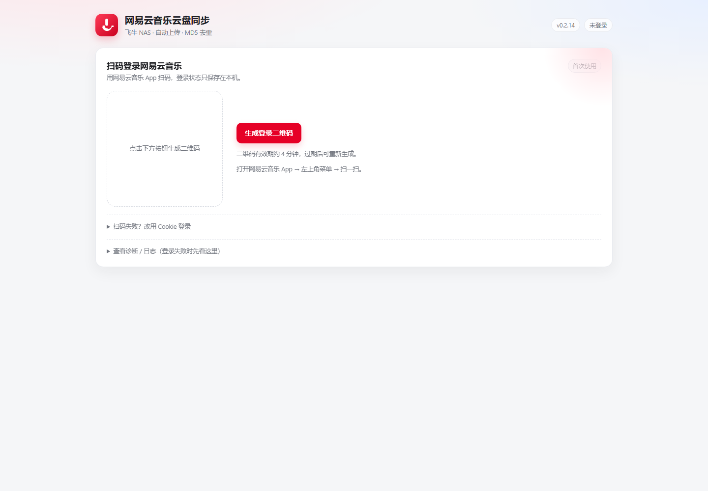

# wy-music-cloud

把本地音乐自动同步到**网易云音乐「音乐云盘」**的飞牛 NAS（fnOS）原生应用，带 Web 管理界面、扫码登录，以及**本地 MD5 + 云端 upload/check 双重去重**。

> 非官方项目。网易云没有公开上传 API，本项目依赖从桌面客户端逆向出的 weapi / eapi / NOS 上传链路，接口随时可能变化。请先看[风险与限制](#风险与限制)。



## 它是什么

这是一个**不依赖 Docker 的 fnOS 原生应用**：应用中心安装后以普通进程运行 Python 服务，通过飞牛统一网关打开内置 Web UI。你可以在界面里完成扫码登录、查看同步状态、修改设置、看日志，不需要 SSH。

后台按设定间隔扫描音乐目录：

- 文件没变就跳过；
- 相同内容只上传一份；
- 上传前再问一次云端，云端已有就不重复上传；
- 单个文件失败只影响它自己，下一轮继续。

## 特性

- **原生飞牛应用**：`.fpk` 安装，带安装向导、启停、升级和卸载回调；**不需要 Docker**。
- **内置 Web UI**：登录、状态、统计、手动同步、演练、设置、日志都在界面里完成。
- **扫码登录**：界面生成网易云登录二维码，手机 App 扫码确认即可；登录态保存在应用数据目录。
- **双重去重**：
  1. **本地去重**：内容相同（MD5 相同）的多个文件只上传一份，其余标记为 `skipped_local`；
  2. **云端去重**：每次真正上传前调用 `/weapi/cloud/upload/check`，`needUpload=false` 说明文件字节已在对象存储，仍需 info/v2 + pub/v2 补建云盘条目。
- **增量同步**：SQLite 记录 `path + size + mtime_ns + md5 + status`，文件没变不重复计算、不重复上传。
- **安全试跑**：界面里的“演练”只检查并显示计划，不分配 token、不上传、不写上传状态。
- **多目录 / 多格式**：可配置多个音乐目录；支持 mp3、flac、m4a、aac、ogg、opus、wav 等。
- **元数据写入**：用 mutagen 读取标题 / 艺术家 / 专辑，上传时一并提交；没有标签时回退到文件名。
- **失败隔离**：单个文件失败只标记该文件，下一轮继续；可重置失败状态重试。
- **中文界面与日志**：状态、错误原因、最近运行记录都直接可读。

## 工作流程

```text
扫描 music_dirs
   │
   ├─ 扩展名 / 排除目录 / 大小过滤
   ├─ size+mtime 未变且已处理 ──► up_to_date
   ├─ 计算 MD5
   │    ├─ 本地已有同 MD5 ──► skipped_local
   │    └─ 云端 check: needUpload=false ──► 跳过字节上传，但仍需 info/v2 + pub/v2 补建云盘条目
   └─ 上传：单个 NOS token alloc →（需要时）NOS 上传 → eapi info/v2 → eapi pub/v2
          └─ 成功 ──► uploaded（记录 songId）
```

去重顺序是“先本地、再云端”。云端 check 返回 needUpload=false 只代表文件字节已在网易云对象存储，并不代表云盘列表里已经有条目；程序仍会调用 eapi info/v2 + eapi pub/v2 补建条目，避免出现“提示已有、云盘却是空的”。

## 安装（飞牛 NAS，推荐）

### 环境要求

- fnOS **1.2.0 或更高版本**；
- x86_64 或 aarch64；
- 应用中心可以安装官方 `python312` 依赖（`manifest` 已声明 `install_dep_apps=python312`，安装时自动处理）。

不需要 Docker，也不需要 NAS 上预装 Python 包；运行时依赖已经随 `.fpk` 打包在应用目录中。

### 1. 安装

从 [Releases](https://github.com/jiu-zui-90817/wy-music-cloud/releases) 下载最新的版本化安装包（例如 `wy-music-cloud-0.2.14.fpk`），打开飞牛 NAS 应用中心 → 手动安装 → 选择该文件。

也可以自行构建：

```bash
git clone https://github.com/jiu-zui-90817/wy-music-cloud.git
cd wy-music-cloud
# 需要 fnOS 官方 fnpack，放到 .tools/ 或加入 PATH
bash scripts/build-fnos.sh
# 产物：dist/wy-music-cloud-<版本>.fpk
```

构建脚本会从 PyPI 下载 x86_64 / aarch64 的 cp312 离线 wheel，再调用 `fnpack` 打包；构建机需要网络，NAS 运行时不需要。

### 2. 安装向导

安装时会要求填写：

| 项目 | 默认值 | 说明 |
| --- | --- | --- |
| 音乐目录 | `/vol1/1000/Music` | NAS 上的绝对路径，必须已存在；应用只读扫描 |
| 同步间隔 | `3600` | 秒，最小 60，最大 86400 |
| 演练模式 | `false` | 第一次可先设为 `true`，只检查不上传 |
| 日志级别 | `INFO` | `DEBUG` / `INFO` / `WARNING` / `ERROR` |

如果音乐目录的权限不允许应用包用户读取，应用中心会提示你授权目录；也可以在文件管理里给应用用户读权限。安装设置保存在应用数据目录的 `settings.json`，升级和修改配置会保留。

### 3. 启动

在应用中心启动「网易云音乐云盘同步」，然后点击桌面图标或应用中心的“打开”。Web UI 通过飞牛统一网关加载，无需额外端口，也无需 SSH。

首次启动会初始化数据目录并拉起后台服务；如果页面暂时打不开，等几秒后刷新，或到应用数据目录查看 `app.log`。

### 4. 扫码登录

1. 在 Web UI 点击「生成登录二维码」；
2. 用网易云音乐手机 App 扫码；
3. 在手机上确认登录；
4. 页面显示账号昵称后即可开始同步。

二维码有效期约 4 分钟，过期后重新生成即可。登录态保存在 `data/session.json`（权限 0600），卸载/升级应用时请一并备份。

### 5. 开始使用

- **立即同步**：马上跑一轮真实上传；
- **演练**：跑一轮只检查、不上传，适合首次确认；
- **刷新**：更新状态统计；
- **设置**：修改音乐目录、同步间隔、日志级别、演练模式；
- **日志**：查看最近运行日志和错误原因。

后台会按 `同步间隔` 自动执行；应用停止后不会运行，重新启动后恢复。第一次建议先点「演练」，确认待上传数量符合预期。

### 数据目录与备份

应用数据目录通常在 `/var/apps/wy-music-cloud/var`（以应用中心显示为准），里面有：

```text
var/
├── settings.json      # 音乐目录、间隔、日志级别
├── app.log            # 应用日志
├── login.txt          # 安装时的登录提示
└── data/
    ├── state.db       # SQLite 同步状态（去重核心）
    ├── session.json   # 登录态（敏感）
    ├── last_run.json  # 最近一次运行结果
    └── qr.png         # 旧版 CLI 登录二维码（如使用过）
```

建议备份 `settings.json`、`data/state.db`、`data/session.json`。`session.json` 等同于账号登录凭证，不要公开。

卸载回调默认保留数据目录，方便重装后继续使用；但应用中心的具体清理行为可能不同，卸载前请先备份。

### 常见问题

**页面打不开 / 502**

先看应用是否已启动。页面底部日志卡片点“查看诊断”，会显示真实的 `app.log` 路径、文件是否存在、数据目录、Python、PID、Socket 和最近日志；即使日志文件因权限没写成，也能看到内存中的日志。首次启动需要等 Python 服务就绪，通常几秒。

**没有日志文件 / 日志是空的**

0.2.4 起服务端带内存日志缓冲。打开页面底部日志卡片，点“诊断信息”或直接点“复制诊断”，会列出真实的 `app.log` 路径、文件是否存在、数据目录、Python、PID、Socket 和最近 120 行日志；即使 `app.log` 因权限没写成，也能看到内存日志。反馈问题时复制整段诊断内容即可。

**提示没有 python312**

在应用中心确认官方 `python312` 依赖已安装；如果安装失败，重新安装本应用，应用中心会重新处理依赖。

**扫码后手机提示“数据加载失败”或“服务器内部错误”**

扫码接口经历过多次风控升级。0.2.6 的 eapi 扫码已经能拿到 `MUSIC_U`，但轮询在吸收 `Set-Cookie` 时可能因同名 Cookie 多 Path 抛异常并回到登录页；0.2.7 已改为直接解析原始 `Set-Cookie`，保留最后一个非空值。0.2.6 起使用网易云 PC 客户端的 `eapi` 接口（`interfacepc.music.163.com`，`type=3`），并带上 `deviceId`、PC 版本号和完整的设备请求头；二维码内容仍为 `https://music.163.com/login?codekey=...`。0.2.5 的 weapi 方案仍可能被部分账号风控拦截，0.2.4 的公开 `/api` 方案缺少设备上下文，手机确认后会报“数据加载失败”。升级到 **0.2.14** 后，在应用中心停止再启动应用，刷新页面并重新生成二维码。若仍然失败：展开登录卡片里的“查看诊断 / 日志（登录失败时先看这里）”，点“复制诊断”把版本、日志路径和最近日志发出来；同时可以用“扫码失败？改用 Cookie 登录”兜底，在电脑浏览器登录 [music.163.com](https://music.163.com)，从开发者工具复制包含 `MUSIC_U` 的 Cookie 粘贴登录。

**扫码后仍显示未登录**

确认手机上点了“确认登录”，并检查系统时间是否准确。二维码过期就重新生成。也可以退出登录后重试。若扫码一直失败，使用登录卡片里的 Cookie 登录兜底。

**安装时提示“音乐目录不可用”**

按提示里的原因处理：`目录不存在` 检查路径；`没有读取权限` 到应用中心授权该目录，或在文件管理里给应用用户 `wy-music-cloud` 读权限；`必须是绝对路径` 确认以 `/` 开头。路径请保持一行，不要从聊天/文件管理器里粘成两行；0.2.1 也会自动去掉粘贴时带入的换行。目录名区分大小写。

**扫描不到音乐**

检查设置里的音乐目录是否是绝对路径、是否存在、应用包用户是否有读权限。目录名区分大小写。

**同步失败 / 上传时提示 [400] 参数错误**

看日志卡片或“查看诊断”里的具体错误。0.2.7 及更早版本把带 weapi 加密的表单发到了 /api/cloud/upload/check，网易云网关按明文接口处理会返回 [400] 参数错误；0.2.8 已统一把 /api/... 改写成 /weapi/...，并校正 ext、length 字段。升级到 0.2.14，停止再启动应用后重试。若仍失败，日志里会有“云盘查重失败”行，连同诊断信息一起反馈。其他常见原因是网络、Cookie 失效、云盘容量或接口变动；单个文件失败不会阻塞其他文件。

**上传时提示 [400] 接口调用失败（提交云盘信息）**

0.2.13 及更早版本用 weapi 提交云盘信息（`/weapi/upload/cloud/info/v2`），2026-11 起该写入接口已失效，无论参数怎么调都返回 [400] 接口调用失败。0.2.14 改为网易云手机客户端的 eapi：`POST https://interface.music.163.com/eapi/upload/cloud/info/v2`，请求体附带 `header` 与 `e_r=false` 后用 AES-128-ECB 加密，Cookie 里带 `MUSIC_U`。提交字段保持：`resourceId` 用同一个 NOS token 的字符串值、`songid` 用 check 返回值的字符串（0 就提交 `"0"`）、`filename` 用真实文件名（含扩展名）、`song` 用标题，不发 `objectKey`；发布接口 `pub/v2` 同样改走 eapi。升级到 0.2.14，停止再启动应用后重试。若仍失败，日志里的“提交云盘信息失败”会带上 filename、songid 和 resourceId，请连同诊断信息反馈。

**上传时提示 Connection refused / 无法获取上传节点**

0.2.10 及更早版本只通过 HTTPS 访问 NOS 的 LBS 节点，并且按旧版 `data.upload[0].host` 解析。部分 NAS 网络到 `https://wanproxy.127.net` 会被拒绝，或网易云返回新的顶层 `upload` 字符串列表，导致每个文件都在“获取上传节点”处失败（`[Errno 111] Connection refused` 或 `NOS 上传节点获取失败`）。0.2.11 先试 HTTPS，失败自动改用 HTTP；同时兼容新旧两种响应，LBS 都不通时回退到 `nosup-jd1.127.net` / `nosup-hz1.127.net`。全部失败时会暂停本轮并把当前文件标记为待处理，不会刷屏。升级后停止再启动应用，确认 NAS 能解析并访问 `wanproxy.127.net`；如果仍失败，把“诊断信息”里的网络错误发出来。

**同步时提示 [405] 操作频繁 / 上传接口被限流**

0.2.9 及更早版本在网易云返回 405 后仍会对每个文件继续请求，短时间内大量分配上传 token 会触发风控，最终整库都变成失败。0.2.10 起所有网易云接口请求都受“请求间隔”节流（默认 1 秒），第一次遇到 405 就暂停本轮，把当前文件标记为待处理，其余文件计入“待续”，下一轮自动继续，不再刷出成百上千条失败。遇到 405 时：等 10～30 分钟让风控冷却；在设置里把“请求间隔”调到 1.5～3 秒；不要连续点“立即同步”。页面会显示“本次同步已暂停”和待续数量。

**很多文件提示没有读取权限 / 失败里“无权限”很多**

应用以包用户 `wy-music-cloud` 运行。如果音乐文件属于其他用户且权限是 600，应用无法读取。到应用中心给本应用授权音乐目录，或在文件管理里给应用用户 `wy-music-cloud` 增加读取权限。0.2.10 会把这类错误单独计入“无权限”，日志每个文件只记一行警告，不再打印整段 traceback；授权后重新同步即可。

**提示“云端已有”，但云盘里是空的**

0.2.8 及更早版本把 needUpload=false 直接当成“云盘已有”并跳过。实际上它只表示文件字节已经在网易云对象存储，云盘条目还没创建；旧版本还可能把 skipped_remote 写进本地状态，导致一直跳过。0.2.9 改为继续调用 info/v2 + pub/v2 补建条目，并且不再信任旧的 skipped_remote 状态、会自动重新检查。升级后如果仍有旧记录，勾选“强制重新检查”再点“立即同步”。

**升级后设置还在吗**

在。设置和状态都在应用数据目录；升级回调只更新程序，不删除数据。

## 可选：Docker / 命令行

如果你不在飞牛上，或者更喜欢容器，仓库仍保留 Docker 和 CLI 方式。它们和原生应用共用同一套同步核心。

### Docker

```bash
cp config.example.yaml config.yaml
# 编辑 config.yaml，至少设置 music_dirs
docker compose build
docker compose run --rm wy-music-cloud login --qr-png /data/qr.png
docker compose run --rm wy-music-cloud sync --dry-run --limit 5
docker compose up -d
```

Docker 细节见 [docs/fnos-deployment.md](docs/fnos-deployment.md) 的 Docker 章节。

### 本机 CLI

需要 Python 3.10+。

```bash
python -m venv .venv
# Windows: .venv\Scripts\activate
# Linux/macOS: source .venv/bin/activate
pip install -e .

wy-music-cloud login
wy-music-cloud --music-dir "D:\Music" sync --dry-run --limit 5
wy-music-cloud --music-dir "D:\Music" sync
```

注意：`--music-dir`、`--config`、`--log-level` 是**全局参数，要写在子命令前面**。

## 配置

原生应用优先使用 Web UI 的设置；CLI 和 Docker 使用 `config.yaml` 或环境变量。完整注释版见 [config.example.yaml](config.example.yaml)。

| 字段 | 默认值 | 说明 |
| --- | --- | --- |
| `music_dirs` | `[]` | 要扫描的音乐目录，可多个；相对路径相对于配置文件所在目录 |
| `data_dir` | `data` | 状态库、会话、最近运行记录目录 |
| `cookie` | `""` | 直接写 Cookie 字符串（不推荐，优先用登录命令或 Web UI） |
| `cookie_file` | `null` | 从文件读取 Cookie |
| `extensions` | 见示例 | 扫描的音频扩展名 |
| `upload_extensions` | 见示例 | 允许上传的扩展名；不在列表里的只统计、不上传 |
| `exclude` | `.*`, `@eaDir`, `#recycle`, `lost+found` | 跳过的目录 / 文件通配符 |
| `interval` | `3600` | 自动同步间隔（秒） |
| `rate_limit` | `1.0` | 网易云接口请求的最小间隔（秒）；Web UI 里叫“请求间隔”，0 表示不限速 |
| `timeout` | `30` | 单次 HTTP 超时（秒） |
| `retries` | `3` | 网络 / 5xx 重试次数 |
| `min_size` | `0` | 小于该字节数的文件跳过 |
| `max_upload_size` | `0` | 大于该字节数的文件标记失败；0 表示不限制 |
| `dry_run` | `false` | 全局试跑；命令行 `--dry-run` 也会打开 |
| `log_level` | `INFO` | `DEBUG` / `INFO` / `WARNING` / `ERROR` |

环境变量优先级高于 YAML，低于命令行参数。支持：

`WY_MUSIC_CONFIG`、`WY_MUSIC_DIRS`、`WY_MUSIC_DATA_DIR`、`WY_MUSIC_COOKIE`、`WY_MUSIC_COOKIE_FILE`、`WY_MUSIC_EXTENSIONS`、`WY_MUSIC_UPLOAD_EXTENSIONS`、`WY_MUSIC_EXCLUDE`、`WY_MUSIC_INTERVAL`、`WY_MUSIC_RATE_LIMIT`、`WY_MUSIC_TIMEOUT`、`WY_MUSIC_RETRIES`、`WY_MUSIC_MIN_SIZE`、`WY_MUSIC_MAX_UPLOAD_SIZE`、`WY_MUSIC_DRY_RUN`、`WY_MUSIC_LOG_LEVEL`。

`WY_MUSIC_DIRS` 可以用系统路径分隔符、逗号或空格分隔多个目录。

## 命令

```text
wy-music-cloud [-c CONFIG] [--music-dir DIR ...] [--log-level LEVEL] <命令>
```

| 命令 | 作用 |
| --- | --- |
| `login` | 扫码 / 手机号 / Cookie 登录并保存会话 |
| `logout` | 删除本地会话文件 |
| `check` | 检查登录状态，打印云盘歌曲数 |
| `scan [--json]` | 只扫描本地文件，不上传 |
| `sync [--dry-run] [--force] [--limit N]` | 执行一轮同步 |
| `daemon [--dry-run] [--force] [--no-run-now]` | 常驻轮询（原生应用不需要） |
| `status [--json]` | 查看状态库统计、最近运行、最近文件 |
| `config` | 打印生效配置（Cookie 已隐藏） |
| `reset-failed` | 把 `failed` 重置为待处理，下一轮重试 |

退出码：`0` 成功；`1` 本轮有文件失败；`2` 配置 / 登录 / API 错误；`130` 被 Ctrl-C 中断。

## 去重与状态

状态库是 `data/state.db`（SQLite，WAL 模式），核心表 `files` 记录：

- `path`：文件绝对路径（主键）；
- `size` / `mtime_ns`：判断文件是否变化；
- `md5`：本地去重与云端 check 的依据；
- `status`：`uploaded`、`skipped_local`、`skipped_remote`、`failed`、`missing` 等；
- `song_id` / `cloud_name`：上传成功后的云盘歌曲信息；
- `attempts` / `last_error`：失败次数与原因。

几个实际行为：

- **同一首歌放到两个目录**：只上传第一份，第二份标记 `skipped_local`；
- **本地状态库丢了**：重新算 MD5 后，云端 check 仍能挡住重复上传；
- **文件被替换（同名不同内容）**：size 或 mtime 变化会触发重新计算和上传；
- **云盘里手动删了歌**：本地状态仍是 `uploaded` 且文件没变，默认不会自动补传；用 `--force` 或删除对应状态行后重跑；
- **文件被移动/改名**：会当作新路径处理，但本地/云端 MD5 去重仍会拦住重复上传。

## 风险与限制

- 使用的是**非公开接口**，随时可能失效；协议集中在 [src/wy_music_cloud/client.py](src/wy_music_cloud/client.py)，细节见 [docs/PROTOCOL.md](docs/PROTOCOL.md)。
- 不要用主账号做高频、大批量上传；建议先用演练 / `--limit` 小流量验证。
- 云盘容量、单文件大小、格式支持由网易云账号决定；本项目不做转码。
- 云盘是扁平结构，本项目不创建文件夹层级。
- 本项目不会修改你的本地音频标签，也不会下载歌曲。
- 原生应用运行时不依赖 Docker / PyPI，但构建 `.fpk` 时需要网络下载离线依赖。
- Web UI 仅对管理员开放，但登录态仍等同于账号凭证；不要把数据目录暴露给不可信用户。
- 请只同步你有权上传的音乐。

## 开发与测试

```bash
pip install -e ".[dev]"
pytest
```

测试覆盖加密参数、Cookie、配置、扫描、标签、状态库、上传协议顺序、去重、失败隔离、dry-run、缺失文件、QR 登录、Web API 和 CLI。

构建飞牛原生应用：

```bash
bash scripts/build-fnos.sh
```

脚本需要 Python 3、网络和 [fnpack](https://developer.fnnas.com/)。图标已提交在仓库中；只有缺失时才会调用 `scripts/make_icons.py`（需要 Pillow）。Windows 下 fnpack 默认把文件打成 0666，构建脚本会调用 `scripts/fix-fpk-modes.py` 把 `cmd/` 下的脚本改为 0755；`app.tgz` 保持不变，因此 `manifest` 里的校验和仍然有效。

## 目录结构

```text
src/wy_music_cloud/
├── cli.py          # 命令行
├── client.py       # 网易云 weapi + NOS 上传（最脆弱的部分）
├── syncer.py       # 扫描 → 去重 → 上传 → 落库
├── state.py        # SQLite 状态库
├── scanner.py      # 目录扫描 / 过滤
├── metadata.py     # mutagen 标签
├── crypto.py       # weapi AES/RSA 加密
├── cookies.py      # Cookie 解析 / 脱敏
├── session.py      # 会话持久化
├── login.py        # 扫码 / 手机号登录
├── daemon.py       # 轮询循环
├── config.py       # YAML + 环境变量配置
├── web.py          # Web UI WSGI 后端 / API
└── webui/          # 内置前端（HTML/CSS/JS）
deploy/fnos/wy-music-cloud/  # 原生 fnOS 应用工程（manifest、wizard、生命周期脚本、离线依赖）
deploy/docker/               # 可选 Dockerfile、entrypoint
scripts/                     # 图标生成、fpk 构建与权限修复
docs/                        # 协议说明、飞牛部署指南
tests/                       # pytest
```

## 参考

- [Binaryify/NeteaseCloudMusicApi](https://github.com/Binaryify/NeteaseCloudMusicApi)：weapi 加密、云盘上传接口的主要参考；
- [lulu-ls/cloud-uploader](https://github.com/lulu-ls/cloud-uploader)：桌面端上传流程参考；
- [Binaryify/NeteaseCloudMusicApi#1851](https://github.com/Binaryify/NeteaseCloudMusicApi/pull/1851)：NOS 上传节点从硬编码 IP 切换到 LBS 的改动。

## License

MIT。
